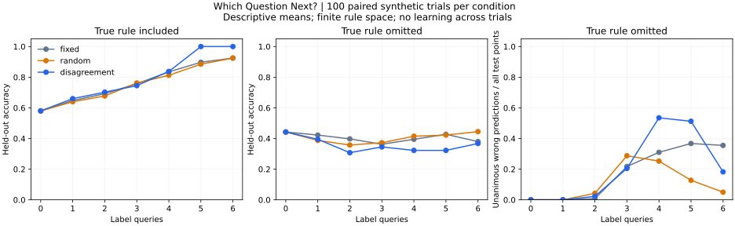

# Which Question Next?

**Question:** When does asking an informative question help an agent learn, and when do its assumptions make that question misleading?

**Status:** Implemented educational baseline with preliminary synthetic results. The initial code and analysis are implemented; personal walkthrough and interpretation are in progress. This is not a novel algorithm, an RL system, or a replication of AdA.

## The experiment in plain language

Imagine objects with four yes/no attributes. A hidden rule assigns each object a label. The agent can request a few labels before predicting labels for different, unseen objects. It starts with 26 possible explanations: individual attributes and simple two-attribute rules. After each answer, it removes explanations that disagree with the observation.

Three strategies choose which object to ask about:

| Strategy | Choice | Uses previous answers? |
| --- | --- | --- |
| Fixed | First remaining object in lexicographic order | No |
| Random | Uniform random remaining object | No |
| Disagreement | Object that most evenly divides the remaining explanations | Yes |

The disagreement strategy is a standard active-learning baseline. Under this uniform, deterministic hypothesis model, it maximizes one-step expected information gain. It does not optimize long-term learning or know which explanation is true.

## Run it

Python 3.10+; no packages, API keys, models, or paid services required for the experiment.

```bash
git clone https://github.com/saraelsh13/portfolio.git
cd portfolio/research/which-question-next
python experiment.py --seeds 100
python -m unittest -v
```

On systems where the command is `python3`, use that instead. The script writes raw trial records, aggregated results, and configuration into `results/`. Optional chart: install `matplotlib`, then run `python plot_results.py`. The committed figure can also be viewed without installing anything. [Beginner walkthrough](WALKTHROUGH.md) | [Notebook](walkthrough.ipynb)

## Design and controls

- There are 16 objects (all combinations of four binary attributes). Each seed shuffles them into 12 query objects and 4 held-out objects. Held-out objects are never query candidates.
- Each condition has 100 trials, seeds 0–99. Strategies share the same target rule and split within a trial. Budgets 0–6 are checkpoints on one trajectory, not independent trials.
- **In-class condition:** the true rule is sampled uniformly from the 26 candidate rules.
- **Omitted-rule condition:** the true rule is XOR of three randomly chosen attributes. It is absent from the candidate rule set.
- Predictions use majority vote over consistent rules; ties predict zero. With no consistent rules, predictions use the observed label majority, with ties zero, and query selection is random except for the fixed strategy.
- Accuracy is measured only on held-out labels. Query cost is the number of requested labels, not runtime or total computation. Selecting informative queries itself costs computation.
- Confidence means candidate agreement under the assumed rule set. It is not a calibrated probability that the model is correct.

## Preliminary results



| Condition and budget | Fixed accuracy | Random accuracy | Disagreement accuracy |
| --- | ---: | ---: | ---: |
| True rule included, 4 queries | 83.5% | 81.25% | 83.75% |
| True rule included, 6 queries | 92.5% | 92.5% | 100% |
| True rule omitted, 4 queries | 39.5% | 41.5% | 32.25% |
| True rule omitted, 6 queries | 38% | 44.5% | 36.75% |

These are descriptive means from the committed [raw records](results/raw_trials.csv), [summary](results/summary.csv), and [configuration](results/config.json). They do not establish statistical superiority or performance in general environments.

At four queries with the true rule omitted, 53.5% of all held-out predictions for disagreement sampling are both unanimous and wrong. Unanimity can reflect shared model limitations. At six queries, 76% of its trials have no consistent explanation left. False certainty then falls partly because empty models are marked inconsistent and cannot count as unanimous. That fall is not evidence of improved calibration.

The interesting result is the contrast: efficient elimination inside an assumed explanation space does not guarantee effective investigation outside it. The omission condition also changes target complexity, so it does not isolate model misspecification as a causal factor. A better control would keep the target distribution fixed and vary the available hypothesis set.

## Limitations and next experiments

This is a tiny, noiseless, finite problem with hand-designed representations. Trials repeat a small set of possible rules and are simulation draws, not independent scientific domains. Four test points give coarse per-trial accuracy. No strategies learn across tasks. No claims about human cognition, LLM reasoning, open-endedness, or self-improvement follow from these results.

Next steps, not yet implemented:

1. Keep the same target rules while changing the agent's hypothesis set, to separate omission from task difficulty.
2. Compare alternative fallback policies and stopping rules. These choices affect the omission condition.
3. Add a mechanism to propose new explanations after inconsistency, and test whether that improves held-out predictions under the same total budget.
4. Study transfer of a query-selection policy across tasks. This would require a new learning component and held-out task families.

## Research connection

[AdA](https://arxiv.org/abs/2301.07608) motivates questions about hypothesis-driven exploration and adaptation. [Learning from unsuccessful proof attempts](https://proceedings.mlr.press/v162/aygun22a.html) motivates questions about useful intermediate experience. This experiment implements neither method. The connection is conceptual: what feedback helps inquiry, and what does an agent retain or rule out as evidence arrives?

## Review and next steps

Review notes, modifications, and experimental decisions will be recorded in the [research log](../research-log.md). Literature notes are preliminary drafts based on abstracts; full-paper review is pending.
